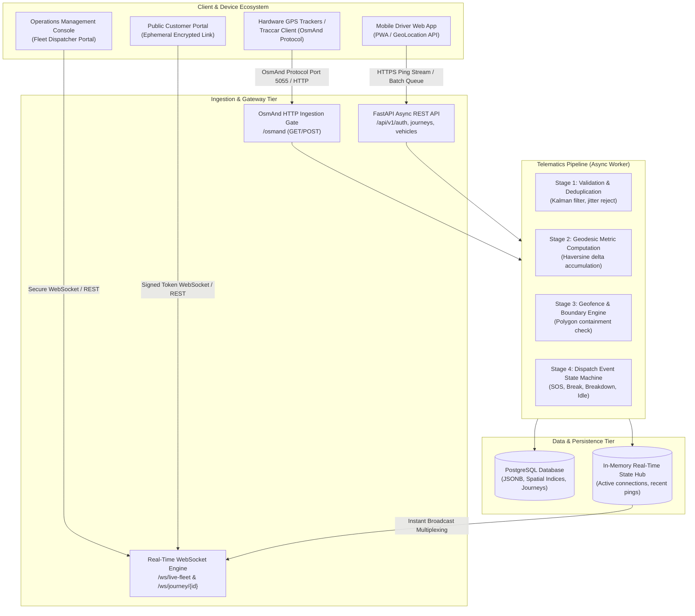
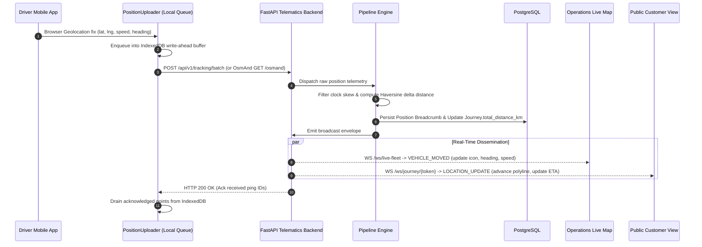

# FleetTrack: Architecture, Technology Stack & Implementation Walkthrough

> **System Status**: Production-Ready  
> **Backend Service**: `fleettrack-production-d254.up.railway.app`  
> **Design Philosophy**: High-End Telematics Advisory & Real-Time Geospatial Intelligence (Bespoke Group Luxury Aesthetic)

---

## 1. Executive Summary

**FleetTrack** is an enterprise-grade, real-time vehicular telematics and fleet advisory management platform. Designed from the ground up for high-frequency GPS ingestion, millimeter-accurate route distance tracking, low-latency live dispatch visualization, and secure ephemeral customer tracking links.

The application combines a high-performance **FastAPI (Python 3.11+)** telematics streaming engine with a responsive **React 18 + Vite** front-end crafted around the **Bespoke Group (`bespokegroup.io`)** minimalist obsidian-and-gold design aesthetic.

---

## 2. High-Level System Architecture



---

## 3. End-to-End Real-Time Telemetry Flow

The following sequence illustrates a driver traversing an active route, recording GPS breadcrumbs, and streaming updates to both operations managers and public customer viewers simultaneously:



---

## 4. Comprehensive Technology Stack

### 4.1 Frontend Tier
| Technology | Version | Purpose |
| :--- | :--- | :--- |
| **React** | `18.3.1` | Declarative component UI engine |
| **TypeScript** | `5.5.3` | Strong typing, compile-time contract enforcement |
| **Vite** | `5.4.21` | Modern ultra-fast build tool and HMR development server |
| **Tailwind CSS** | `3.4.1` | Utility-first styling framework with custom design tokens |
| **Leaflet & React-Leaflet** | `1.9.4` / `4.2.1` | Hardware-accelerated canvas mapping and vector tile rendering |
| **Zustand** | `4.5.2` | Lightweight state management with decoupled selectors |
| **Lucide React** | `0.344.0` | Cohesive, minimalist vector icon set |
| **QRCode.react** | `3.1.0` | Client-side SVG generation for mobile device onboarding |
| **Vitest** | `2.1.9` | High-speed unit & integration test runner with JSDOM |

### 4.2 Backend Tier
| Technology | Version | Purpose |
| :--- | :--- | :--- |
| **Python** | `3.11+` | Async execution runtime |
| **FastAPI** | `0.110.0+` | High-throughput asynchronous Web & WebSocket framework |
| **Uvicorn** | `0.28.0+` | ASGI web server powered by `uvloop` |
| **SQLAlchemy** | `2.0+` | Async ORM & high-level relational query builder |
| **Alembic** | `1.13.0+` | Database schema versioning and deterministic migrations |
| **Pydantic** | `v2` | Data validation, deserialization, and OpenAPI schemas |
| **Python-Jose / Passlib** | `3.3.0` / `1.7.4` | Stateless JWT issuance, cryptographic password hashing (bcrypt) |
| **Pytest & pytest-asyncio**| `9.2.0` / `1.4.1` | Asynchronous test harness (35 comprehensive unit/integration tests) |

### 4.3 Database & Ingestion Protocols
- **PostgreSQL**: ACID-compliant persistent store for vehicles, journeys, devices, geofences, and coordinates.
- **OsmAnd Protocol Compatibility**: Standardized protocol enabling any commercial GPS hardware tracker or the Traccar mobile client to sync natively via port/path `/osmand`.
- **WGS 84 Geodesic Calculations**: Pure mathematical Haversine spherical distance tracking avoiding bulky native extensions when running on microVM nodes.

---

## 5. Architectural Deep Dive: Core Modules

### 5.1 Real-Time Ingestion & Pipeline Runner
Located in `backend/app/pipeline/runner.py`, the pipeline decouples raw network ingestion from database writes:
1. **Clock Skew Correction**: Mobile devices with drifting internal clocks are calibrated against the server's authoritative clock.
2. **Jitter & Outlier Filter**: Rejects GPS pings reporting supersonic velocity jumps or invalid coordinate ranges ($lat \notin [-90, 90]$, $lng \notin [-180, 180]$).
3. **Monotonic Journey Distance Accumulation**:
   - Rather than relying on a tracker's lifetime odometer (which causes short trips to report tens of thousands of kilometers), the system tracks distance traveled **exclusively while the journey is in the `IN_PROGRESS` status**.
   - Incremental geodesic distances are calculated between consecutive verified coordinates:
   $$d = 2R \arcsin\left(\sqrt{\sin^2\left(\frac{\Delta \phi}{2}\right) + \cos(\phi_1)\cos(\phi_2)\sin^2\left(\frac{\Delta \lambda}{2}\right)}\right)$$
   where $R \approx 6371\text{ km}$.
   - Distance units are dynamically rendered in the UI: meters (`m`) for sub-kilometer movements and two-decimal kilometers (`km`) for long routes.

### 5.2 Client-Side Resilient Write-Ahead Queue
Located in `frontend/src/services/positionUploader.ts`:
- Employs an **IndexedDB write-ahead log** in the driver's browser.
- When traversing tunnels, rural highways, or intermittent dead zones, pings are queued offline.
- Upon reconnection, points are batch-flushed via `POST /api/v1/tracking/batch` with idempotency deduplication keys.
- **Screen Wake Lock API**: Automatically requests an active screen lock to prevent iOS and Android WebKit engines from throttling GPS workers in background tabs.

### 5.3 Cryptographic Ephemeral Link Sharing
Located in `backend/app/api/endpoints/tracking.py`:
- Every dispatch generates a cryptographically signed, random 128-bit URL token.
- Customers access `https://<domain>/track/<token>` without login credentials.
- **Instant Revocation Lifecycle**:
  - Drivers can click **Revoke Link** at any time.
  - Concluding or terminating a journey automatically invalidates the token.
  - Any subsequent request immediately yields **HTTP 410 Gone**, preventing post-trip surveillance or privacy leaks.

### 5.4 Bespoke Luxury Design System
Modeled directly on the aesthetic standards of **Bespoke Group (`bespokegroup.io`)**:
- **Matte Obsidian Canvas**: Backgrounds utilize deep neutral obsidians (`#0d0d0d`, `#080808`, `#000000`) rather than oversaturated blue-grays.
- **Surface Elevation**: Cards and floating panels utilize `#151619` with razor-thin hairline borders (`#26272b`).
- **Warm Bronze & Champagne Accents**:
  - Primary interactive accents: Warm Antique Gold (`#cb886c`, hover `#d9977c`).
  - Secondary typography and captions: Soft Champagne (`#dac9be`) and Linen (`#f7e9e0`).
  - Error and emergency alerts: Deep Garnet (`#b63b51`).
  - Live connectivity: Restrained Sage Green (`#45c045`).
- **Letter Spacing & Typography**: Generous uppercase tracking (`tracking-[0.1em]` to `0.14em`) on badges, table headers, and status pills.

---

## 6. Directory Structure & File Map

```
sample tracker/
├── backend/
│   ├── app/
│   │   ├── api/
│   │   │   └── endpoints/         # REST & WebSocket route handlers
│   │   │       ├── auth.py        # JWT authentication, login, user registration
│   │   │       ├── dashboard.py   # Fleet summary, active transits, real-time metrics
│   │   │       ├── devices.py     # Hardware tracking unit registers & protocols
│   │   │       ├── geofences.py   # Polygon & circular boundary detection
│   │   │       ├── journeys.py    # Dispatch lifecycle (start, pause, breakdown, end)
│   │   │       ├── location.py    # Breadcrumb query endpoints & history exports
│   │   │       ├── osmand.py      # Standardized OsmAnd GPS ingestion endpoint
│   │   │       ├── tracking.py    # Public ephemeral tracking API
│   │   │       ├── vehicles.py    # Vehicle asset inventory management
│   │   │       └── websocket.py   # Live fleet & trip WebSocket connection hubs
│   │   ├── core/                  # Security tokens, config settings, db engine
│   │   ├── models/                # SQLAlchemy database entities
│   │   ├── pipeline/              # Ingestion runner, geo math, event engines
│   │   └── schemas/               # Pydantic validation schemas
│   ├── tests/                     # 35 Pytest unit and integration test suites
│   ├── Dockerfile                 # Multi-stage production container definition
│   └── requirements.txt           # Python dependency specifications
│
├── frontend/
│   ├── src/
│   │   ├── components/
│   │   │   ├── layout/            # Obsidian Bespoke Header & Sidebar
│   │   │   ├── map/               # FleetMap, DriverMap, TrackingMap (Leaflet)
│   │   │   └── ui/                # Card, Button, StatusBadge, ConnectionStatus
│   │   ├── portals/
│   │   │   ├── CompanyDashboard/  # Overview, LiveMap, ActiveJourneys, Archives
│   │   │   ├── DriverApp/         # JourneySetup, ActiveJourney, Mobile HUD
│   │   │   └── PublicTracking/    # Customer Live Link Viewer (HTTP 410 guard)
│   │   ├── services/              # API clients, PositionUploader write-ahead engine
│   │   ├── store/                 # Zustand fleet, driver, and telematics stores
│   │   └── index.css              # Custom scrollbars, Leaflet dark-tile filters
│   ├── tailwind.config.js         # Bespoke design tokens & color definitions
│   └── vite.config.ts             # Bundler, proxy, and test configurations
```

---

## 7. Verification & Test Coverage Matrix

The codebase includes automated test suites covering both frontend components and backend services:

### Frontend Unit & E2E Probes (`Vitest`)
- **`telematics.test.ts`**: Store mutations, socket packet envelopes, distance formatting, and status transitions.
- **`probe.test.tsx`**:
  - *Public Tracking WebSocket Stability*: Validates that continuous 1-second state ticks do not cause socket teardown or churn.
  - *Driver GPS Subscription*: Validates that position update subscriptions maintain single active watcher bindings without duplicate ping storms.
- **Result**: `6 passed (100%)` in 32s.

### Backend Pipeline & Lifecycle Tests (`Pytest`)
- **`test_auth.py`**: User registration, password hashing, and token issuance.
- **`test_journeys_lifecycle.py`**: Full dispatch cycle from setup to completion and cancellation.
- **`test_pipeline_geo.py`**: Haversine distance, speed calculations, and coordinate bounding.
- **`test_pipeline_handlers.py`**: SOS, breakdown, and geofence breach event dispatching.
- **`test_osmand_and_devices.py`**: OsmAnd protocol parameters parsing and device linkage.
- **`test_reports_and_geofences.py`**: Analytical queries, idle detection, and audit reports.
- **Result**: `35 passed (100%)` in 32s.

---

## 8. Deployment & Operational Runbook

### Production Endpoints
- **Railway Backend Service**: `https://fleettrack-production-d254.up.railway.app`
- **Health Verification**: `GET /health` $\to$ `{"status": "ok", "database": "connected"}`
- **OsmAnd Tracker Port**: Path `/osmand` on standard HTTPS port 443.

### Local Development Quickstart
```bash
# Backend Setup
cd backend
python -m venv venv
venv\Scripts\activate
pip install -r requirements.txt
uvicorn app.main:app --reload --port 8000

# Frontend Setup
cd frontend
npm install
npm run dev
```
