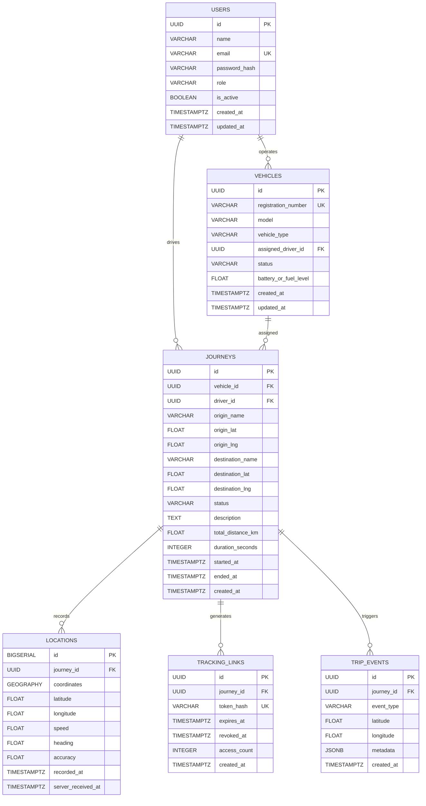

# Database Design & PostGIS Architecture
## Corporate Fleet Tracking and Geospatial Navigation System

---

## 1. Overview & Geospatial Engine Justification

The storage layer is engineered with **PostgreSQL 16** and the **PostGIS 3.4 extension**, supplemented by **Redis 7** for ephemeral caching. High-frequency telemetry requires both transactional consistency for financial/operational records and spatial indexing for sub-millisecond geofencing and historical trajectory queries.

### Why Standard SQL Is Insufficient and PostGIS Is Mandatory:
1. **Curvature of the Earth (WGS 84 / EPSG:4326)**:
   - The Earth is an oblate spheroid. Standard planar Pythagorean geometry ($\sqrt{\Delta x^2 + \Delta y^2}$) incurs substantial positional error (up to 0.5% distortion), which compounds over long commercial trucking routes.
   - PostGIS provides the `GEOGRAPHY` type, which automatically executes spherical trigonometric calculations on the WGS 84 ellipsoid without manual projection conversions.
2. **Spatial Indexing (`GIST` / R-Tree)**:
   - Standard B-Tree indexes only index one-dimensional data (e.g. sorting by numbers or strings).
   - PostGIS uses **Generalized Search Trees (`GIST`)** implementing R-Trees, allowing spatial bounding box queries ($O(\log N)$) across tens of millions of coordinate points (e.g., finding all vehicles within a 5 km warehouse radius).
3. **Advanced Spatial Functions**:
   - `ST_Distance(geom1, geom2)`: Exact geodetic distance in meters.
   - `ST_MakeLine(geom ORDER BY recorded_at)`: Aggregates scattered GPS points into a connected spatial linestring.
   - `ST_Simplify(geom, tolerance)`: Uses the Douglas-Peucker algorithm to downsample 10,000 raw GPS points to 200 points for web dashboard rendering, reducing network payload size by 98%.

---

## 2. Entity Relationship Diagram (ERD)



---

## 3. Data Dictionary & Detailed Schema Definitions

### 3.1 Table: `users`
Stores user credentials, contact information, and role-based permissions.
```sql
CREATE TABLE users (
    id UUID PRIMARY KEY DEFAULT gen_random_uuid(),
    name VARCHAR(255) NOT NULL,
    email VARCHAR(255) UNIQUE NOT NULL,
    password_hash VARCHAR(255) NOT NULL,
    role VARCHAR(50) NOT NULL DEFAULT 'DRIVER' CHECK (role IN ('DRIVER', 'FLEET_MANAGER', 'ADMIN')),
    is_active BOOLEAN NOT NULL DEFAULT TRUE,
    created_at TIMESTAMPTZ NOT NULL DEFAULT NOW(),
    updated_at TIMESTAMPTZ NOT NULL DEFAULT NOW()
);

CREATE INDEX idx_users_email ON users(email);
CREATE INDEX idx_users_role ON users(role);
```

### 3.2 Table: `vehicles`
Represents physical fleet assets with operational status.
```sql
CREATE TABLE vehicles (
    id UUID PRIMARY KEY DEFAULT gen_random_uuid(),
    registration_number VARCHAR(64) UNIQUE NOT NULL,
    model VARCHAR(128) NOT NULL,
    vehicle_type VARCHAR(64) NOT NULL DEFAULT 'VAN' CHECK (vehicle_type IN ('VAN', 'TRUCK', 'CAR', 'MOTORCYCLE')),
    assigned_driver_id UUID REFERENCES users(id) ON DELETE SET NULL,
    status VARCHAR(50) NOT NULL DEFAULT 'AVAILABLE' CHECK (status IN ('AVAILABLE', 'IN_TRANSIT', 'MAINTENANCE', 'OFFLINE')),
    battery_or_fuel_level FLOAT DEFAULT 100.0,
    created_at TIMESTAMPTZ NOT NULL DEFAULT NOW(),
    updated_at TIMESTAMPTZ NOT NULL DEFAULT NOW()
);

CREATE INDEX idx_vehicles_registration ON vehicles(registration_number);
CREATE INDEX idx_vehicles_status ON vehicles(status);
CREATE INDEX idx_vehicles_assigned_driver ON vehicles(assigned_driver_id);
```

### 3.3 Table: `journeys`
Core lifecycle entity capturing each dispatch, starting from departure to completion.
```sql
CREATE TABLE journeys (
    id UUID PRIMARY KEY DEFAULT gen_random_uuid(),
    vehicle_id UUID NOT NULL REFERENCES vehicles(id) ON DELETE CASCADE,
    driver_id UUID NOT NULL REFERENCES users(id) ON DELETE RESTRICT,
    origin_name VARCHAR(255) NOT NULL,
    origin_lat FLOAT NOT NULL,
    origin_lng FLOAT NOT NULL,
    destination_name VARCHAR(255) NOT NULL,
    destination_lat FLOAT NOT NULL,
    destination_lng FLOAT NOT NULL,
    status VARCHAR(50) NOT NULL DEFAULT 'PENDING' CHECK (status IN ('PENDING', 'IN_PROGRESS', 'PAUSED', 'COMPLETED', 'CANCELLED')),
    description TEXT,
    total_distance_km FLOAT DEFAULT 0.0,
    duration_seconds INTEGER DEFAULT 0,
    started_at TIMESTAMPTZ NOT NULL DEFAULT NOW(),
    ended_at TIMESTAMPTZ,
    created_at TIMESTAMPTZ NOT NULL DEFAULT NOW()
);

CREATE INDEX idx_journeys_vehicle_id ON journeys(vehicle_id);
CREATE INDEX idx_journeys_driver_id ON journeys(driver_id);
CREATE INDEX idx_journeys_status ON journeys(status);
CREATE INDEX idx_journeys_started_at ON journeys(started_at DESC);
```

### 3.4 Table: `locations` (Spatial PostGIS Table)
Stores immutable GPS telemetry pings.
```sql
CREATE TABLE locations (
    id BIGSERIAL PRIMARY KEY,
    journey_id UUID NOT NULL REFERENCES journeys(id) ON DELETE CASCADE,
    coordinates GEOGRAPHY(Point, 4326) NOT NULL,
    latitude FLOAT NOT NULL,
    longitude FLOAT NOT NULL,
    speed FLOAT NOT NULL DEFAULT 0.0,
    heading FLOAT NOT NULL DEFAULT 0.0,
    accuracy FLOAT NOT NULL DEFAULT 0.0,
    recorded_at TIMESTAMPTZ NOT NULL,
    server_received_at TIMESTAMPTZ NOT NULL DEFAULT NOW()
);

-- Spatial GIST Index for geofencing and bounding queries
CREATE INDEX idx_locations_coordinates ON locations USING GIST(coordinates);

-- Compound index for journey playback ordered chronologically
CREATE INDEX idx_locations_journey_recorded ON locations(journey_id, recorded_at ASC);
```

### 3.5 Table: `tracking_links`
Manages the lifecycle of temporary public and company viewer tracking tokens.
```sql
CREATE TABLE tracking_links (
    id UUID PRIMARY KEY DEFAULT gen_random_uuid(),
    journey_id UUID NOT NULL REFERENCES journeys(id) ON DELETE CASCADE,
    token_hash VARCHAR(64) UNIQUE NOT NULL, -- SHA-256 of the random secret
    expires_at TIMESTAMPTZ NOT NULL,
    revoked_at TIMESTAMPTZ,
    access_count INTEGER NOT NULL DEFAULT 0,
    created_at TIMESTAMPTZ NOT NULL DEFAULT NOW()
);

CREATE INDEX idx_tracking_links_token_hash ON tracking_links(token_hash);
CREATE INDEX idx_tracking_links_journey_id ON tracking_links(journey_id);
CREATE INDEX idx_tracking_links_expires_at ON tracking_links(expires_at);
```

### 3.6 Table: `trip_events`
Audit log of key trip events (SOS, breakdowns, break pauses, delays).
```sql
CREATE TABLE trip_events (
    id UUID PRIMARY KEY DEFAULT gen_random_uuid(),
    journey_id UUID NOT NULL REFERENCES journeys(id) ON DELETE CASCADE,
    event_type VARCHAR(64) NOT NULL CHECK (event_type IN ('DEPARTURE', 'STOP', 'BREAK_START', 'BREAK_END', 'SOS', 'BREAKDOWN', 'ARRIVAL')),
    latitude FLOAT NOT NULL,
    longitude FLOAT NOT NULL,
    metadata JSONB DEFAULT '{}'::jsonb,
    created_at TIMESTAMPTZ NOT NULL DEFAULT NOW()
);

CREATE INDEX idx_trip_events_journey ON trip_events(journey_id);
CREATE INDEX idx_trip_events_type ON trip_events(event_type);
```

---

## 4. Redis Key Naming Convention & Expiration Policies

Redis is utilized exclusively for ephemeral, high-throughput caching and pub/sub:

| Key Pattern | Data Structure | TTL | Purpose |
| :--- | :--- | :--- | :--- |
| `token:{sha256_hash}` | String (`journey_id`) | 24 Hours (or until journey ends) | Maps tracking token hash to active journey ID for instantaneous lookup. |
| `vehicle:{vehicle_id}:latest` | Hash | None (overwritten) | Stores the latest known position, speed, heading, and timestamp. |
| `journey:{journey_id}:latest` | Hash | 24 Hours | Stores the latest journey telemetry for fast recovery. |
| `fleet:geo` | Sorted Set (GEO) | Dynamic | Enables spatial queries (e.g. `GEORADIUS fleet:geo lng lat 10 km`). |
| `channel:journey:{journey_id}` | Pub/Sub Channel | N/A | Broadcasts real-time coordinate updates to connected WebSocket viewers. |
| `channel:fleet:broadcast` | Pub/Sub Channel | N/A | Broadcasts fleet-wide status changes (vehicle offline, emergency SOS). |
