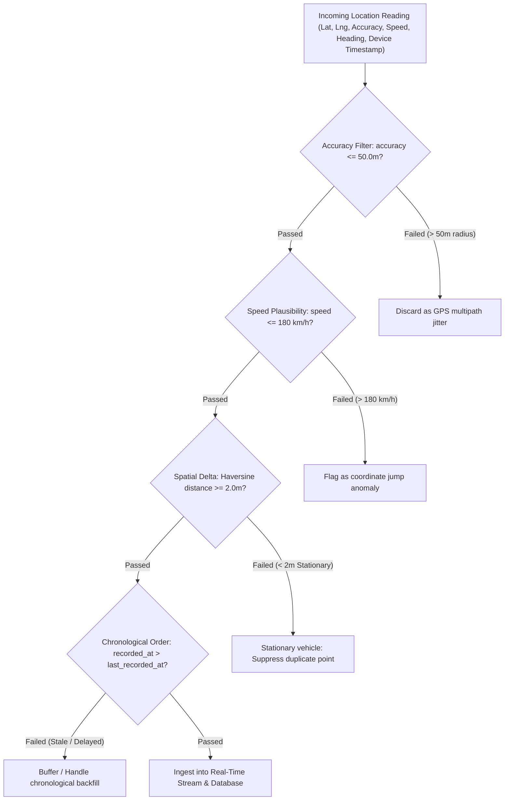

# GPS Tracking Engine & Geospatial Ingestion Workflow
## Corporate Fleet Tracking and Geospatial Navigation System

---

## 1. Mobile GPS Acquisition Pipeline

Accurate GPS tracking from mobile devices presents several fundamental physics and OS-level challenges:
1. **Multipath Reflection & Urban Canyons**: Signals bouncing off skyscrapers cause sudden 50–200 meter erroneous spikes.
2. **Device Battery Optimization**: Android and iOS aggressively throttle or kill background web applications when the screen turns off.
3. **Network Blind Spots**: Cellular handovers and rural highways frequently sever HTTP sessions.

### Browser Geolocation vs. Native Android Foreground Service:
- **Development & PWA Mode**: Utilizes `navigator.geolocation.watchPosition` with options:
  - `enableHighAccuracy: true` (engages GPS/GNSS radio instead of Wi-Fi tri-angulation).
  - `maximumAge: 0` (forces fresh sensor reads, bypassing stale cache).
  - `timeout: 10000` (10-second threshold before raising timeout exception).
- **Production Android Architecture (Capacitor Integration)**:
  - Mobile browsers **suspend JavaScript timers** when minimized.
  - A production fleet deployment requires a **Foreground Service** with a persistent Android notification drawer (`Ongoing Notification`), utilizing Android's `FusedLocationProviderClient`.
  - In this project, we structure Capacitor bridge hooks allowing seamless compilation to native Android APKs with background location permissions (`ACCESS_FINE_LOCATION`, `ACCESS_COARSE_LOCATION`, `ACCESS_BACKGROUND_LOCATION`, and `FOREGROUND_SERVICE_LOCATION`).

---

## 2. Telemetry Validation & Filtering Pipeline

Every incoming coordinate ping undergoes a multi-stage validation pipeline before it touches the database or real-time broadcast:



---

## 3. High-Fidelity Coordinate Storage & Processing

Once validated:
1. The point is transformed to PostGIS native spatial geometry:
   ```sql
   ST_SetSRID(ST_MakePoint(:longitude, :latitude), 4326)::geography
   ```
2. The latest vehicle location cache is updated in Redis via `GEOADD`:
   ```bash
   GEOADD fleet:geo 80.2707 13.0827 "vehicle_uuid"
   ```
3. A lightweight JSON packet is published to the Redis Pub/Sub channel for instantaneous distribution to WebSocket subscribers.
