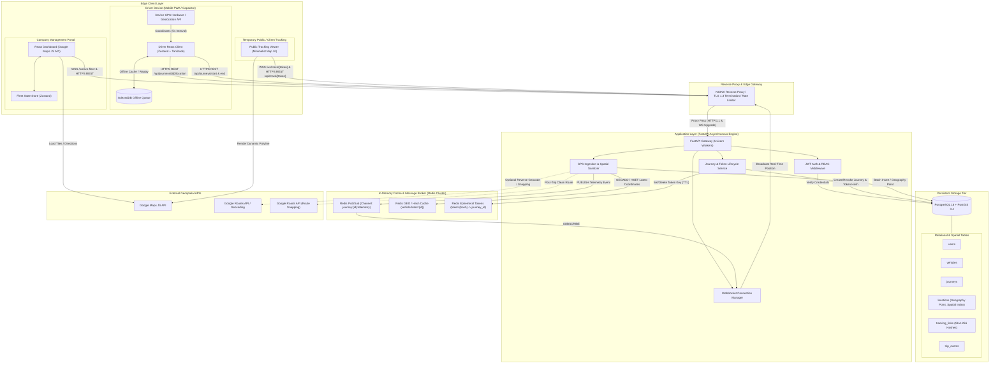
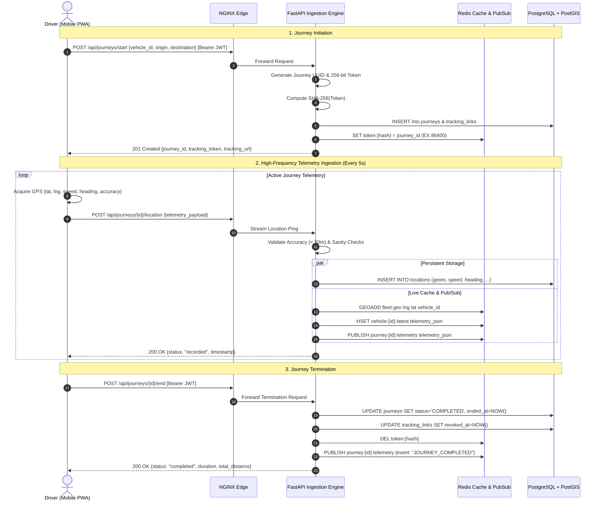
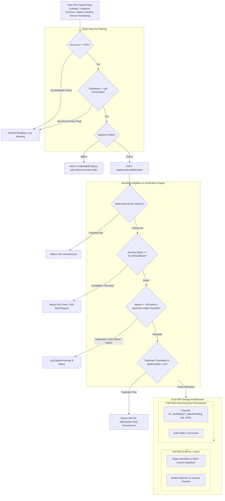
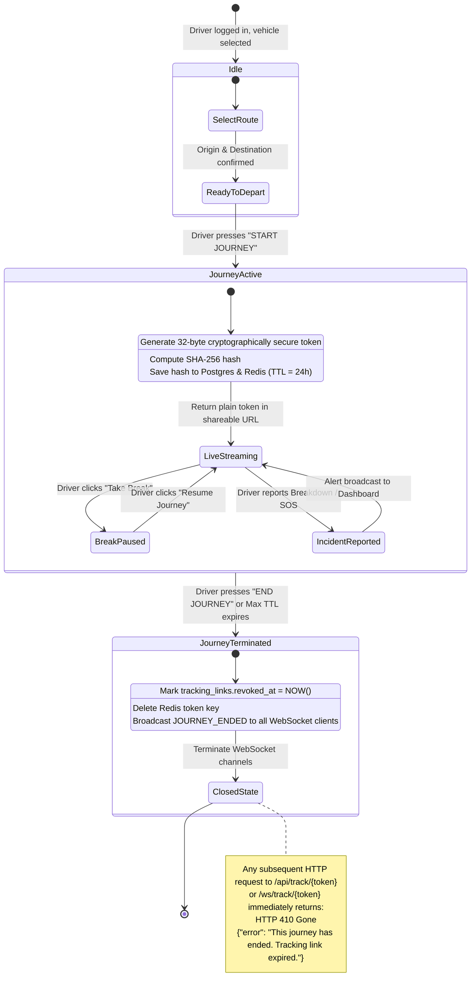
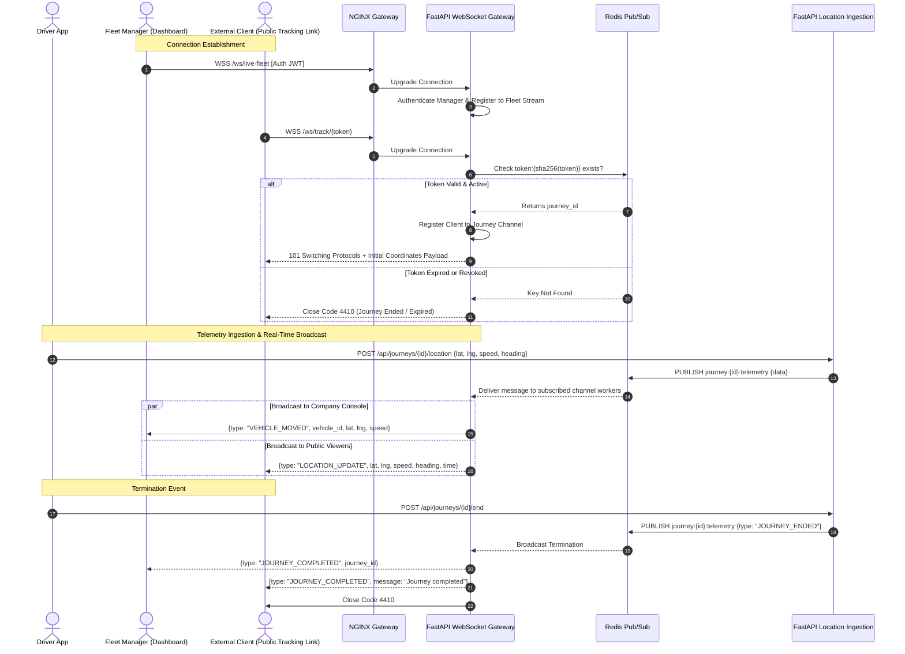
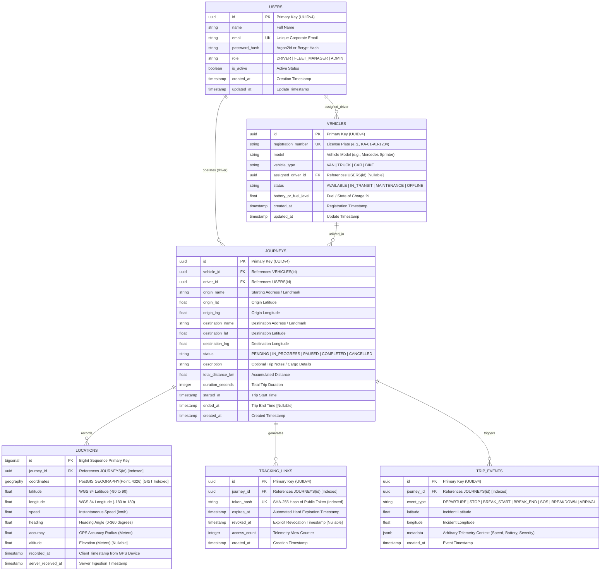
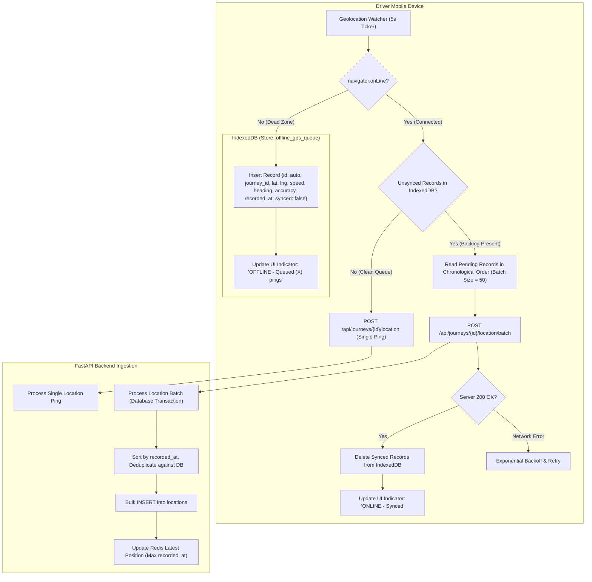
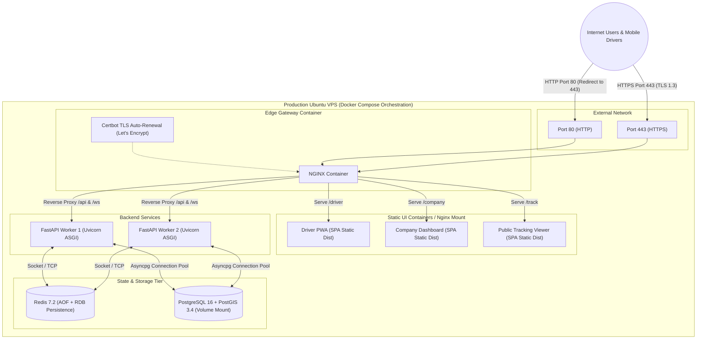

# System Architecture & Technical Design Document
## Corporate Fleet Tracking and Geospatial Navigation System

---

## 1. Executive Summary & Architectural Vision

The **Corporate Fleet Tracking and Geospatial Navigation System** is an enterprise-grade platform designed to track corporate fleets, manage journeys in real time, and broadcast live vehicular movements to company management and temporary external stakeholders with high fidelity, zero link leakage, and sub-second latency.

The system is bifurcated into two primary user domains:
1. **Driver Mobile Portal (PWA / Hybrid Mobile)**: Captures high-accuracy GPS coordinates, buffers coordinates during offline periods via IndexedDB, transmits telemetry over HTTPS/WSS, and provides journey management (Start, End, Break, Emergency SOS).
2. **Company Management Portal (Web Dashboard)**: Provides fleet managers with bird's-eye visibility over all active vehicles, live journey paths, historical playback, emergency alerts, and vehicle telematics.

Crucially, the architecture features an **Ephemeral Journey-Specific Tracking Engine**:
- Every journey generates a cryptographically random, collision-resistant tracking token (256-bit entropy via `secrets.token_urlsafe(32)`).
- The raw token is **never** stored in plaintext in the persistent database; only its **SHA-256 hash** is persisted.
- Active tokens are cached in Redis with strict TTLs and mapped to active journeys.
- Multiple viewers (dispatchers, clients, logistics coordinators) can simultaneously view the live journey via WebSockets and read-only REST endpoints.
- When the driver clicks **END JOURNEY**, the tracking token is permanently revoked, Redis keys are purged, WebSocket connections are terminated with code `4410 (Journey Ended)`, and any subsequent access returns `HTTP 410 Gone`.
- A newly initiated journey generates an entirely new token; tokens are never recycled or reused.

---

## 2. Comprehensive System Architecture Diagram

---

## 3. Technology Architecture & Stack Rationale

| Layer | Selected Technology | Architectural Justification |
| :--- | :--- | :--- |
| **Frontend Framework** | React 18 + TypeScript + Vite | Strict type safety across geospatial coordinates and tracking payloads. Lightning-fast Vite HMR for development, highly optimized tree-shaken bundles for mobile PWA. |
| **Styling & UI** | Tailwind CSS + Lucide Icons | Utility-first CSS ensuring lightweight, zero-runtime overhead, high responsiveness on mobile devices and responsive dark/light data-dense operations consoles. |
| **State & Data Fetching** | Zustand + TanStack Query (React Query) | Zustand delivers minimal-boilerplate, non-re-rendering high-frequency state updates for live GPS streaming; TanStack Query handles caching, background revalidation, and optimistic updates for REST resources. |
| **Mobile Runtime** | PWA + Capacitor 6 | Progressive Web App for frictionless instant browser deployment across Android/iOS devices; Capacitor provides a bridge to native Android foreground location services for production background tracking. |
| **Offline Telemetry** | IndexedDB (idb wrapper) | Unlike `localStorage` (limited to 5MB, synchronous, blocking), IndexedDB handles thousands of serialized GPS coordinate tuples asynchronously during cellular blind spots. |
| **Backend Framework** | Python 3.12+ / FastAPI | Native asynchronous I/O (`asyncio`), high-throughput ASGI server (Uvicorn), automatic OpenAPI generation, and seamless integration with Pydantic v2 for sub-millisecond serialization of high-frequency GPS pings. |
| **Database & Spatial** | PostgreSQL 16 + PostGIS 3.4 | PostGIS provides true spatial indexing (`GIST` on `geography(Point, 4326)`), exact geodetic distance calculations on the WGS 84 ellipsoid (`ST_Distance`, `ST_DWithin`), and spatial clustering. |
| **Caching & Messaging**| Redis 7 | Sub-millisecond Pub/Sub messaging for broadcasting GPS coordinates to WebSocket workers; Redis `GEOADD`/`GEOPOS` for instant spatial queries; key expiration (`EX`) for automated token invalidation. |
| **Real-Time Protocol** | WebSockets (RFC 6455) | Full-duplex, low-overhead communication eliminating HTTP polling overhead (saving 95% bandwidth per GPS ping compared to traditional polling). |
| **Reverse Proxy & TLS** | NGINX | Terminates TLS 1.3, multiplexes HTTP/1.1 and WebSockets (`Upgrade` header handling), buffers slow mobile connections, and enforces rate-limiting at the edge. |
| **Mapping Engine** | Google Maps JavaScript API | Industry standard for geospatial fidelity, high-precision vector maps, road geometry, real-time traffic overlays, and smooth coordinate interpolation. |

---

## 4. Driver-to-Backend Communication Architecture

The driver client communicates with the backend via a hybrid architecture:
1. **Control Operations (Start Journey, End Journey, Status Changes, Breakdown/SOS)**: Dispatched over authenticated HTTPS REST endpoints using standard Bearer JWT tokens.
2. **GPS Stream Ingestion**: Dispatched over HTTPS POST (`/api/journeys/{id}/location`) with support for single-ping updates (every 5 seconds) or batched array syncs (`/api/journeys/{id}/location/batch`) when reconnecting from network dropouts.

---

## 5. GPS Data Transmission & Ingestion Architecture

A critical failure point in naive tracking systems is treating every raw GPS coordinate as genuine and assuming persistent network connectivity. The ingestion engine enforces strict filtering, validation, and deduplication:

---

## 6. Journey Creation & Ephemeral Tracking Link Lifecycle

The tracking link security model is designed to withstand leakage and guarantee zero persistence after journey conclusion:

---

## 7. WebSocket Real-Time Communication Architecture

---

## 8. Database Entity Relationship (ER) Diagram

### Why PostGIS is Essential:
1. **True Geodesic Calculations**: Standard SQL floats calculate distance via Euclidean plane approximations ($\sqrt{\Delta x^2 + \Delta y^2}$), which suffers significant distortion over spherical Earth coordinates. PostGIS `geography(Point, 4326)` implements exact great-circle formulas over the WGS 84 ellipsoid.
2. **Spatial Indexing (`GIST`)**: Enables $O(\log N)$ spatial bounding-box lookups (`&&`, `ST_DWithin`, `ST_Contains`) across millions of historical GPS pings.
3. **Route Simplification**: PostGIS provides `ST_Simplify(ST_MakeLine(geom), 0.0001)` to reduce complex multi-hour polylines into optimized geometry for fast rendering on web maps.

---

## 9. Offline GPS Synchronization Architecture

Mobile phones routinely encounter cellular dead zones (tunnels, basements, remote highways). The driver client implements a resilient store-and-forward architecture:

---

## 10. Deployment Architecture (Docker & Production VPS)

---

## 11. Security Architecture & Threat Mitigation Matrix

| Potential Threat / Attack Vector | Architectural Mitigation Mechanism |
| :--- | :--- |
| **Tracking Token Guessing / Brute Force** | 256-bit cryptographic entropy (`secrets.token_urlsafe(32)`) yields $2^{256}$ permutations. Rate limiting at NGINX level ($10\text{ req/min}$ per IP on `/api/track/`). |
| **Database Compromise & Token Leakage** | Database stores strictly `SHA-256(token)`. Even if read access to `tracking_links` table is compromised, original tokens cannot be reversed. |
| **Stale Link Access After Trip Completion** | Multi-tier revocation: (1) Database `revoked_at` timestamp recorded; (2) Redis key instantly deleted; (3) Active WebSocket sessions immediately terminated with custom code `4410`; (4) Subsequent requests yield `HTTP 410 Gone`. |
| **GPS Spoofing / Multipath Jump Attacks** | Spatial anomaly filters in FastAPI verify speed delta ($\le 180\text{ km/h}$) and reasonable acceleration between consecutive timestamps. Coordinates with GPS accuracy $> 50\text{m}$ are rejected. |
| **Cross-Tenant Vehicle / Journey Snooping** | Role-Based Access Control (RBAC): Drivers can only access vehicles assigned to their account; Company managers can only view journeys within their corporate tenant scope. |
| **Google Maps API Key Scraping** | Keys are restricted by HTTP Referrer in Google Cloud Console (`*.yourdomain.com/*`). Sensitive backend calls (Geocoding, Routes, Roads) execute strictly server-side. |
